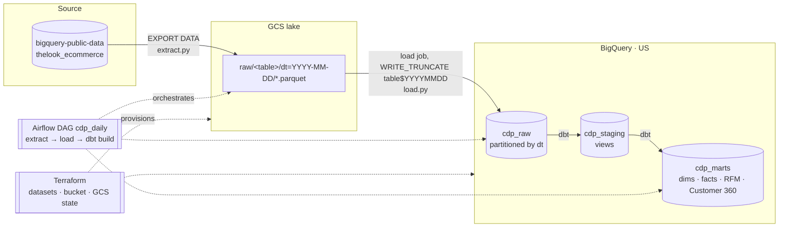
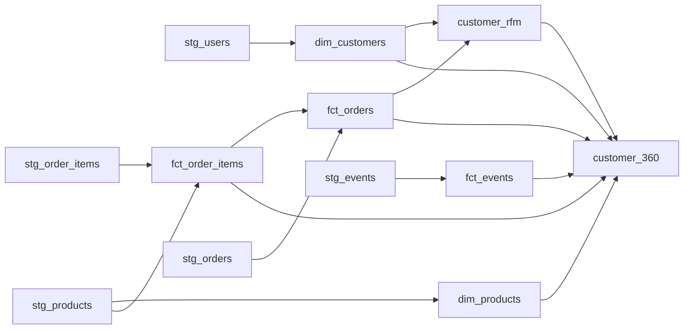

# mini-CDP

A small Customer Data Platform on GCP, built on the public
`bigquery-public-data.thelook_ecommerce` dataset. It lands raw data in a GCS lake,
loads it into partitioned BigQuery tables, and models it with dbt into dimensions,
facts, RFM segments and a one-row-per-customer **Customer 360** table, orchestrated
daily by Airflow.

**Stack:** BigQuery · GCS · dbt Core (dbt-bigquery) · Airflow 3 (Astro CLI, local Docker) · Terraform · GitHub Actions

## Architecture





## Layers

| Layer | Dataset | What lives here |
|---|---|---|
| Lake | `gs://mini-cdp-dedonzz-lake/raw/` | Parquet exports, one folder per table per day (`dt=`), 90-day lifecycle |
| Raw | `cdp_raw` | Data as landed, day-partitioned on `dt`, plus `_extracted_at` |
| Staging | `cdp_staging` | dbt views: renamed, typed (money → `NUMERIC`), one snapshot day |
| Marts | `cdp_marts` | `dim_customers`, `dim_products`, `fct_order_items`, `fct_orders`, `fct_events` (incremental), `customer_rfm`, `customer_360` |

## Key design decisions

- **Snapshot vs incremental extraction.** `orders`/`order_items` change status over time and have no
  `updated_at`, so they are exported as a full daily snapshot; `users`/`products` are small and also
  snapshotted. `events` is append-only and large, so only the `created_at` day is extracted.
- **Idempotency everywhere.** Every step is keyed by the logical date `ds` and *replaces* exactly one
  partition: `EXPORT DATA ... overwrite=true` into `dt=<ds>/`, a load job with `WRITE_TRUNCATE` into
  `table$YYYYMMDD`, and dbt `insert_overwrite` with static partitions for `fct_events`. Re-runs and
  backfills never duplicate rows.
- **Partition pruning by construction.** Staging selects one snapshot partition with a *constant*
  date (`snapshot_dt()` macro: `--vars '{ds: ...}'`, else the latest partition from
  `INFORMATION_SCHEMA.PARTITIONS`), so BigQuery prunes at compile time.
- **One-off events backfill.** The public `events` table is unpartitioned, so each daily extract scans
  ~385 MB. History was loaded once with a single query (`backfill_events.py`) instead of N daily runs.
- **Customer = every registered user.** Users who never purchased stay in Customer 360 and get the
  `non_purchaser` RFM segment. Revenue excludes cancelled and returned items, defined once in
  `fct_order_items.is_revenue`.
- **RFM scoring.** R and M use `NTILE(5)` with a deterministic tie-breaker; F uses fixed thresholds
  because most customers have one order and `NTILE` would split identical values into different scores.
- **dbt over Dataform.** dbt has a larger ecosystem (packages like `dbt_utils`, tests, docs) and is
  portable across warehouses; Dataform is GCP-native and needs no extra runtime. For a GCP-only team
  Dataform is a valid choice.
- **US multi-region.** The public dataset is in `US` and BigQuery cannot query across locations.

## Data quality

dbt tests on every model: primary keys (`unique`, `not_null`), referential integrity (`relationships`),
`accepted_values`, ranges (`dbt_utils.accepted_range`), row-count parity of Customer 360 vs customers,
and a reconciliation test (`orders.item_count` = number of order items). Broken keys fail the pipeline
(`error`); source-data quirks only `warn`. Source freshness warns after 36 h and errors after 72 h.

## Cost controls

- Every BigQuery job is capped with `maximum_bytes_billed` (1 GB); queries are dry-run first.
- Explicit column lists (no `SELECT *`); facts are partitioned and clustered.
- Load jobs and exports are free; a full daily run scans ~0.45 GB (within the 1 TB/month free tier).
- GCS lifecycle deletes lake files after 90 days; a TWD 200 budget alert is set on the project.

## Security

- No service-account keys anywhere. Locally everything uses gcloud ADC; Airflow mounts the ADC file
  read-only. In production the workers would run as an attached service account / Workload Identity.
- Terraform state lives in a versioned GCS bucket (`mini-cdp-dedonzz-tfstate`) created outside the
  config, so `terraform destroy` cannot delete it.
- `users` contains PII (name, email, address). In a real deployment these columns would get
  policy tags / column-level security, and marts would expose hashed emails only.

## Run it

```bash
uv sync                                                    # Python 3.11 + dbt
uv run python ingestion/extract.py --ds 2026-11-01         # public dataset → GCS
uv run python ingestion/load.py --ds 2026-11-01            # GCS → cdp_raw
cd dbt && uv run dbt deps && uv run dbt build --profiles-dir . --vars '{ds: 2026-11-01}'

cd airflow && astro dev start                              # DAG cdp_daily, UI on the printed URL
```

Infrastructure: `cd terraform && terraform init && terraform apply`.
Tear down with `terraform destroy` (the state bucket is kept).

## CI

GitHub Actions runs without any cloud credentials: `ruff`, `sqlfluff`, `dbt parse`, and
`terraform fmt` / `validate`.
